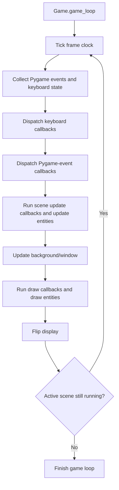

# Architecture

> **Status:** pygame_handler is under active development. Treat internal names and behavior as implementation details until the public API and compatibility policy are stabilized.

## Overview

`pygame_handler` is a Python package built around a game-loop controller, scene management, event callbacks, and Pygame display/input handling. The source code uses the `src/` layout:

```text
src/pygame_handler/
├── system/       # Game-loop orchestration
├── scene/        # Scenes, scene stack, lifecycle and event dispatch
│   └── events/   # Callback registries, contexts, trigger/policy enums
├── graphics/     # Window, background, entities and frame clock
├── movement/     # Delta-time-based movement helpers
├── spritesheets/ # Sprite-sheet slicing and animation helpers (experimental)
├── helper/
│   ├── debugger/ # Debug flags
│   └── logger/   # Messages and notifications
└── config.py     # General configuration values
```

The package root's `__init__.py` currently does not re-export the library API. Import classes from their submodules, for example `from pygame_handler.system import Game`.

## Main runtime flow

The main controller is `Game` in `pygame_handler.system.core`. Its frame loop follows this high-level sequence:



The frame clock stores elapsed time in seconds as `clock_handler.dt`. The current scene receives that value in its update context and in its `update(dt)` call.

### Runtime components

- **`system/core.py` — `Game`:** creates the scene handler and window, loads debug/environment configuration, collects input, and coordinates each frame.
- **`scene/Scene.py` — `Scene` and `Scenes_handler`:** represents a running scene, owns scene-local event registries and entities, dispatches input, and runs update/draw callbacks. `Scenes_handler` manages the active scene and scene transitions.
- **`graphics/main.py`:** provides `Window`, `Background`, `EntitiesHandler`, basic entity/graphics objects, and `clock_handler`. `Window` initializes Pygame, owns the display surface and clock, and presents frames.
- **`movement/main.py`:** calculates movement amounts using the clock's delta time. It is a helper rather than a complete physics or collision system.
- **`helper/debugger/flags.py`:** stores class-level debugging flags. **`helper/env.py`** reads environment options (and calls `load_dotenv()` when imported). **`helper/logger/`** contains message and notification helpers.
- **`spritesheets/`:** contains sprite-sheet slicing, sprite instances, animation handlers, and cooldown utilities. This part is experimental; see [the spritesheets notes](src/pygame_handler/spritesheets/README.md) for current limitations.

## Event system

The event implementation lives in `scene/events/`.

- **`Callbacks`** stores callback registration records and invokes callbacks in registration order.
- **`EventsDict`** maps Pygame event types or custom trigger values to callback collections.
- **`EventsHandler`** groups Pygame, keyboard, and scene lifecycle/update/draw callback registries.
- **`StateEventContext`** passes the active scene, the triggered event (when applicable), and optional delta time to callbacks. **`DrawEventContext`** passes the active scene to draw callbacks.
- **Global and local registries:** `Scenes_handler.Global_Events` is shared by scenes; each `Scene` also has its own `events_handler`. Pygame-event dispatch combines the relevant global and local registrations.

The `TRIGGERS.ALL` value is intended for callbacks that respond to any Pygame event. Callback registration accepts one trigger or an iterable of triggers; registering several triggers for one callback shares its registration record.

### Invocation-policy caveat

The enum currently defines `EVERY_TIME`, `ONCE_PER_LOOP`, and `ONCE_PER_EVENT`. In the current scene dispatcher, only `ONCE_PER_LOOP` has distinct handling: the same registration is prevented from running more than once while a batch of Pygame events is being processed. The other policies do not yet have separate behavior in that dispatcher and should not be treated as distinct guarantees until that implementation and its tests are completed.

## Configuration and dependencies

Project metadata and optional dependencies are declared in `pyproject.toml`.

- Minimum declared Python version: **3.15**.
- Install either the `pygame` extra or the `pygame-ce` extra; do not install both into the same environment.
- The `test` extra installs pytest.
- Debug flags can be set through environment variables. Individual flag values accept `1`, `true`, or `on` (case-insensitive); `ALL` is used as the fallback for individual options that are not set.

## Tests and CI

Automated tests are under `tests/`; currently, the tracked test module focuses on event callbacks and registration. GitHub Actions installs the project with the `test` and `pygame-ce` extras, compiles `src/` and `tests/`, then runs pytest on Ubuntu with Python 3.15.2. The workflow does not currently exercise Windows activation scripts or a full Windows runtime.

Run the local checks from the repository root with the intended environment active:

```console
python -m compileall -q src tests
python -m pytest -ra --strict-config --strict-markers
python -m pip check
```

## Known limitations

- The project is still evolving; test coverage is currently narrow relative to the number of modules.
- The invocation policies need clearer, fully tested semantics.
- The spritesheets package has unresolved import/export and dependency issues documented in its own README. Do not assume it is ready for use by downstream applications until those are fixed and tested.
- The Windows helper scripts are convenient local tools, but their behavior is not currently covered by CI.
