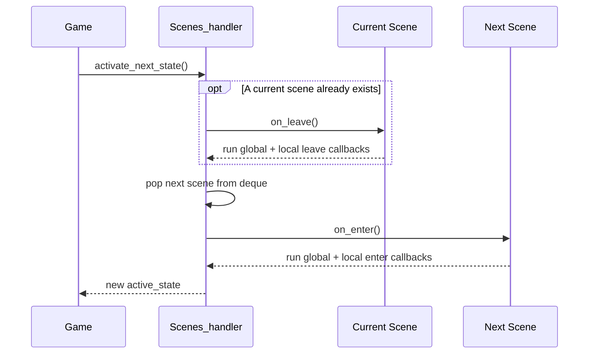

# Design Overview

This document explains the responsibilities and current boundaries of the major components. It complements [Architecture](../../ARCHITECTURE.MD) with a more practical view of how the pieces work together.

## Responsibilities

| Component | Responsibility | Main location |
|---|---|---|
| `Game` | Coordinates startup and the per-frame loop | `system/core.py` |
| `Scenes_handler` | Tracks active/previous scenes and the scene queue | `scene/Scene.py` |
| `Scene` | Owns local entities and callback registries; handles input, update, and draw | `scene/Scene.py` |
| `EventsHandler` | Groups Pygame, keyboard, and scene-level callback registries | `scene/events/events.py` |
| `EventsDict` | Maps Pygame event triggers to callback records | `scene/events/events.py` |
| `Callbacks` | Stores callback records and invokes them with a context | `scene/events/events.py` |
| `Window` | Owns the Pygame display surface, background, and frame clock | `graphics/main.py` |
| `EntitiesHandler` | Updates and draws the entities belonging to a scene | `graphics/main.py` |
| `StateEventContext` / `DrawEventContext` | Passes event, scene, and timing data into callbacks | `scene/events/events.py` |

## Scene transition lifecycle

The current scene handler calls `on_leave()` on the scene being left and `on_enter()` on the scene becoming active. Those methods invoke both global and scene-local callbacks for the corresponding lifecycle event.



The queue stores scenes that will be activated by `activate_next_state()`. The default scene is created by `Scenes_handler`; the game setup adds it to the queue if no scene was queued before startup. Check the implementation before assuming that the queue behaves like a conventional LIFO stack in every scenario.

## Event registration design

There are two levels of event registration:

- **Global:** `Scenes_handler.Global_Events`, shared at the class level.
- **Scene-local:** `scene.events_handler`, belonging to one scene.

Callbacks registered globally are intended to respond regardless of which scene is active; local callbacks belong to their owning scene. Pygame-event dispatch currently merges global and local event maps before matching each event.

Registration can be explicit:

```python
import pygame
from pygame_handler.scene.events import invocation_policy

def on_key_down(context):
    print("Active scene:", context.active_state)
    print("Pygame event:", context.triggered_event)

scene.events_handler.Pygame_Event.register(
    pygame.KEYDOWN,
    on_key_down,
    invocation_policy=invocation_policy.ONCE_PER_LOOP,
)
```

A single callback can be registered for multiple triggers by passing an iterable:

```python
scene.events_handler.Pygame_Event.register(
    [pygame.KEYDOWN, pygame.KEYUP],
    on_key_down,
)
```

The context type and callback behavior should be checked against the code for the specific dispatcher. The current policy implementation is incomplete; see [patterns and caveats](patterns.md).

## Extension guidance

When adding a feature, prefer the following boundaries:

1. Put frame sequencing and application-level coordination in `Game`, not in a callback registry.
2. Put scene-specific behavior and scene-owned entities in `Scene`.
3. Keep event matching and callback invocation in the event subsystem instead of duplicating it in every scene.
4. Keep drawing and display ownership in `Window` and entity drawing in the entity objects.
5. Add tests for observable behavior before promising a new API in documentation.

These are design guidelines for maintaining the current structure, not an assertion that all responsibilities are perfectly separated today.
