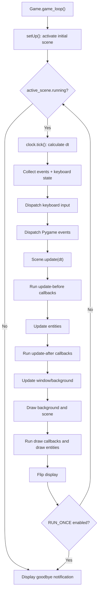
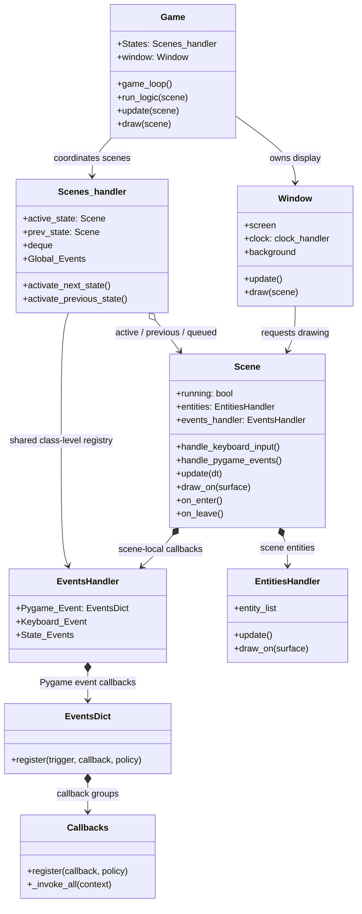
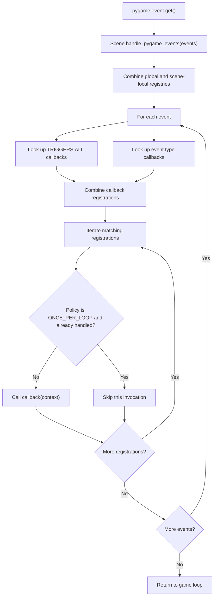

# Graphs

These diagrams are based on the current source in `src/pygame_handler/`. They are intended to help readers trace the flow of control before reading individual modules.

## 1. Main game-loop flow

`Game.game_loop()` initializes the active scene, then repeats frame timing, input dispatch, updates, and drawing while the active scene's `running` flag is true.

**Important:** this loop describes the current ordering. In particular, keyboard dispatch occurs before Pygame-event dispatch, and the scene's update and draw phases are separate.

## 2. Component relationship graph

The line from `Scenes_handler` to `EventsHandler` represents the class-level `Global_Events` registry. It is shared across handler instances, unlike the local `events_handler` owned by each scene.

## 3. Pygame-event dispatch

The scene dispatcher combines the global and scene-local Pygame-event registries, checks the current event's specific trigger and the `TRIGGERS.ALL` trigger, then invokes the resulting callback registrations.

### Dispatch caveats

- `ONCE_PER_LOOP` currently tracks a registration in a set while processing one batch of Pygame events. It is not a global once-per-frame guarantee across keyboard, update, draw, or other callback groups.
- `EVERY_TIME` and `ONCE_PER_EVENT` do not currently have separate branches in the Pygame-event dispatcher. Do not rely on them as distinct policies until their semantics are implemented and tested.
- Keyboard handling currently invokes the `pressed` registry for both the just-pressed and continuously held key states. The separate `streamed` registry exists but is not used by that method yet; this is a code issue to resolve, not intended behavior.
