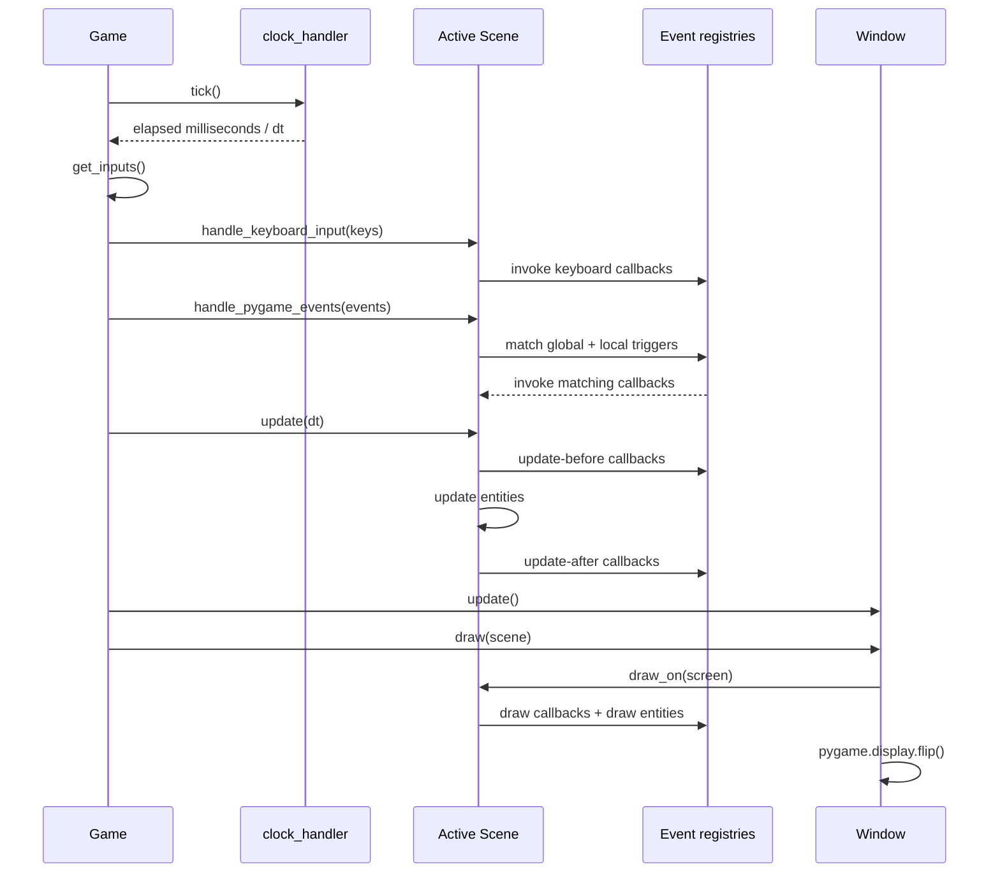
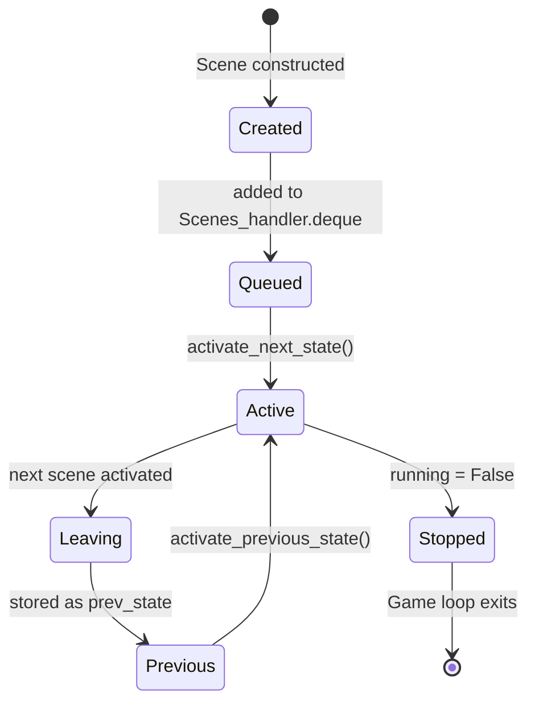

# UML Diagrams

These UML-style diagrams document the current class structure and runtime interactions in `src/pygame_handler/`. They are implementation diagrams, not a promise that the API is stable.

## 1. Class diagram

This class diagram focuses on the main runtime components and callback system.

```mermaid
classDiagram
    direction LR

    class Game {
      +States: Scenes_handler
      +DEFAULT_STATE: Scene
      +window: Window
      +setUp()
      +game_loop()
      +run_logic(scene)
      +update(scene)
      +draw(scene)
    }

    class Scenes_handler {
      +active_state: Scene
      +prev_state: Scene
      +default_state: Scene
      +deque
      +Global_Events: EventsHandler
      +activate_next_state()
      +activate_previous_state()
    }

    class Scene {
      +running: bool
      +handler: Scenes_handler
      +entities: EntitiesHandler
      +events_handler: EventsHandler
      +handle_keyboard_input()
      +handle_pygame_events(events)
      +update(dt)
      +draw_on(surface)
      +on_enter()
      +on_leave()
    }

    class Window {
      +screen: Surface
      +clock: clock_handler
      +background: Background
      +update()
      +draw(scene)
    }

    class clock_handler {
      +dt: float
      +fps_target: float
      +tick()
    }

    class Background {
      +color
      +image
      +update()
      +draw_on(surface)
    }

    class EntitiesHandler {
      +entity_list
      +update()
      +draw_on(surface)
    }

    class Default_Entity_object {
      +x
      +y
      +graphics: Graphics_object
      +update()
      +draw_on(surface)
    }

    class Graphics_object {
      +image: Surface
      +update()
      +draw_on(surface, dest)
    }

    class EventsHandler {
      +State_Events
      +Keyboard_Event
      +Pygame_Event: EventsDict
    }

    class StateEvents {
      +draw_events_Queue: EventsQueue
      +update_events_Queue: EventsQueue
      +on_enter: Callbacks
      +on_leave: Callbacks
      +on_exit: Callbacks
      +on_start: Callbacks
    }

    class KeyboardEvents {
      +streamed: Callbacks
      +pressed: Callbacks
    }

    class EventsDict {
      +registered_actions
      +register(triggers, func, invocation_policy)
      +decorator_register(trigger, invocation_policy)
    }

    class EventsQueue {
      +before: Callbacks
      +after: Callbacks
    }

    class Callbacks {
      +registered_actions
      +register(action, invocation_policy)
      +_invoke_all(context)
    }

    class CallbackInfo {
      +action
      +invocation_policy
    }

    class StateEventContext {
      +active_state: Scene
      +triggered_event
      +dt: float
    }

    class DrawEventContext {
      +active_state: Scene
    }

    Game *-- Scenes_handler : owns
    Game *-- Window : owns
    Scenes_handler o-- "0..*" Scene : manages queued scenes
    Scenes_handler --> "0..1" Scene : active_state
    Scenes_handler --> "0..1" Scene : prev_state
    Scenes_handler ..> EventsHandler : class-level Global_Events
    Scene *-- EntitiesHandler : owns
    Scene *-- EventsHandler : owns local handlers
    Window *-- clock_handler : owns
    Window o-- Background : optional
    EntitiesHandler o-- "0..*" Default_Entity_object : stores
    Default_Entity_object *-- Graphics_object : owns
    EventsHandler *-- StateEvents
    EventsHandler *-- KeyboardEvents
    EventsHandler *-- EventsDict
    StateEvents *-- EventsQueue
    StateEvents *-- Callbacks
    KeyboardEvents *-- Callbacks
    EventsQueue *-- Callbacks
    EventsDict o-- Callbacks : callback groups
    Callbacks o-- CallbackInfo : registration records
    Callbacks ..> StateEventContext : state/Pygame dispatch
    Callbacks ..> DrawEventContext : draw dispatch
```

**Reading the relationships:** solid composition diamonds indicate objects created and owned by the containing component during normal initialization. The global registry is a class attribute on `Scenes_handler`, so it is shared across instances rather than owned exclusively by one `Game`. Some types shown are simplified to keep the diagram readable.

## 2. Game-loop sequence diagram

This shows the main call order in the current implementation. The exact callbacks invoked depend on which registries have been populated.

## 3. Scene lifecycle state diagram

The state diagram is conceptual: `Scene` does not currently implement a formal enum-backed lifecycle state. The diagram summarizes the common scene-manager path rather than adding a new runtime state machine.
